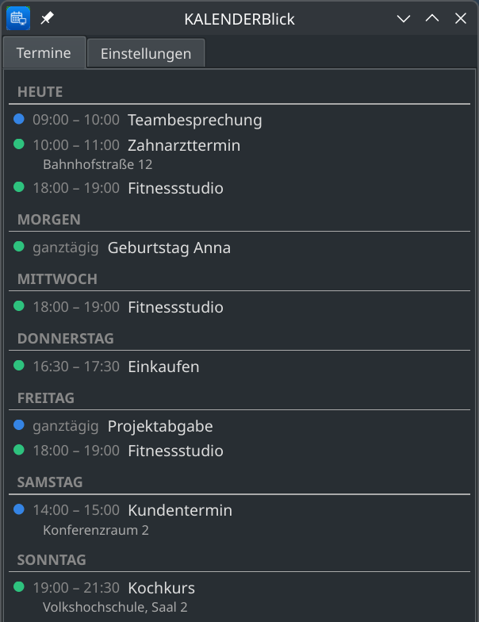
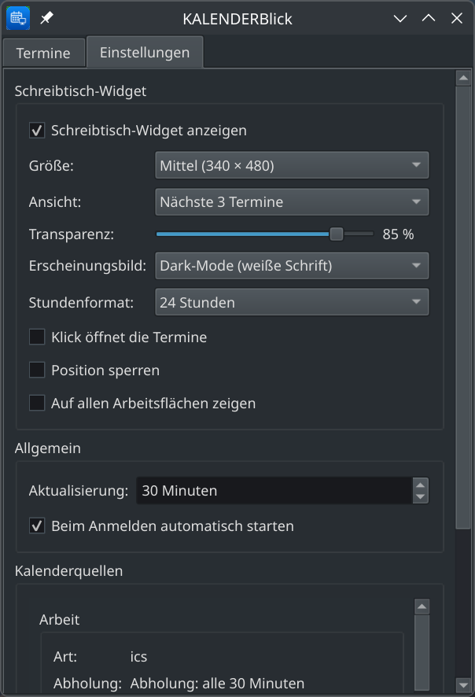
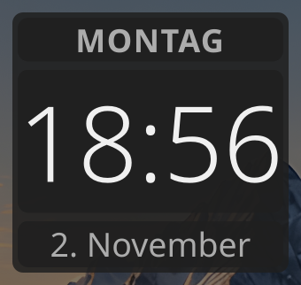
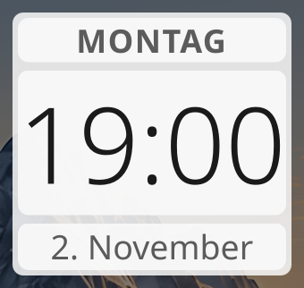
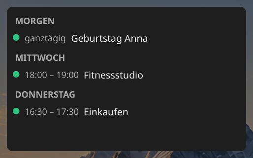
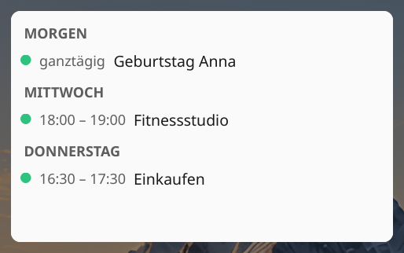
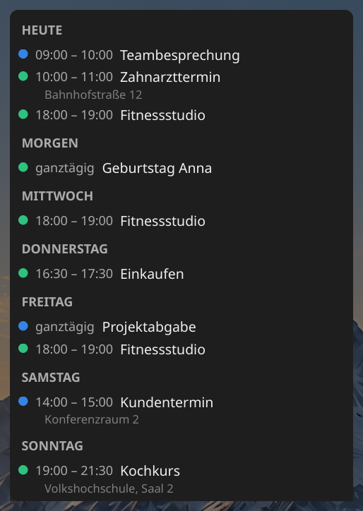
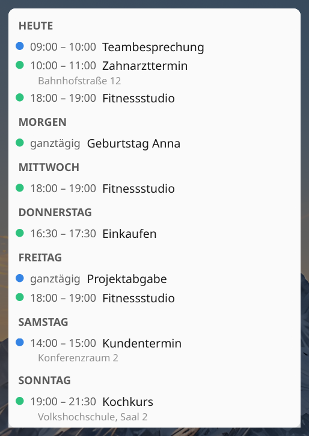

<p align="center">
  
</p>

# Anleitung

Schritt für Schritt von der Installation bis zum fertig eingerichteten
Schreibtischwidget. Alle Screenshots zeigen erfundene Beispieltermine,
keine echten Daten.

## 1. Voraussetzungen

KALENDERBlick braucht ein eingerichtetes Thunderbird-Profil mit
mindestens einem Kalender - egal ob örtlich gespeichert oder abonniert
(ICS, CalDAV). Thunderbird selbst muss beim Benutzen von KALENDERBlick
nicht laufen.

## 2. Installieren

**Manjaro, Arch**

```bash
pamac install python-dateutil python-pyqt6 python-pipx
pipx install --system-site-packages git+https://github.com/Stephan-Lefty/KALENDERBlick.git
```

**Debian, GuideOS, Ubuntu**

```bash
sudo apt install python3-dateutil python3-pyqt6 pipx
pipx install --system-site-packages git+https://github.com/Stephan-Lefty/KALENDERBlick.git
```

Danach stehen zwei Befehle zur Verfügung: `kalenderblick` (Kommandozeile)
und `kalenderblick-fenster` (nur das Hauptfenster, ohne Leistensymbol und
Schreibtischwidget).

## 3. Menüeintrag und Symbole einrichten

`pipx install` legt nur die beiden Befehle an, keinen Eintrag im
Anwendungsmenü und keine Symbole. Das holt dieser Block nach - einmalig,
unabhängig vom Betriebssystem:

```bash
VENV=$(pipx environment --value PIPX_LOCAL_VENVS)/kalenderblick
BILDER=$(find "$VENV" -type d -name bilder | head -1)

for groesse in 16 22 24 32 48 64 128 256 512; do
  mkdir -p ~/.local/share/icons/hicolor/${groesse}x${groesse}/apps
  cp "$BILDER/symbol-${groesse}.png" \
     ~/.local/share/icons/hicolor/${groesse}x${groesse}/apps/kalenderblick.png
done

mkdir -p ~/.local/share/applications
cat > ~/.local/share/applications/kalenderblick.desktop << 'EOF'
[Desktop Entry]
Type=Application
Name=KALENDERBlick
Comment=Thunderbirds Termine auf dem Schreibtisch und in der Kontrollleiste
Exec=kalenderblick start
Icon=kalenderblick
Terminal=false
Categories=Office;Calendar;Utility;
StartupNotify=false
EOF
update-desktop-database ~/.local/share/applications
```

Danach steht „KALENDERBlick" im Anwendungsmenü - meist ohne Neustart von
Plasma. Wer lieber das fertige `.deb`- oder Arch-Paket nutzt (siehe
`packaging/`), bekommt Menüeintrag und Symbole automatisch mit.

## 4. Kurz prüfen, ob das Profil gefunden wird

```bash
kalenderblick pruefen
kalenderblick kalender
```

`pruefen` zeigt, welches Thunderbird-Profil gefunden wurde und ob die
Kalenderdateien lesbar sind. `kalender` listet jeden gefundenen Kalender
mit Art und Abholfrequenz - das sollten echte, bekannte Kalendernamen
sein. Wenn hier nichts oder das falsche Profil erscheint, lässt sich ein
bestimmtes Profil von Hand vorgeben (siehe Abschnitt „Kalenderquellen"
weiter unten).

## 5. Starten

```bash
kalenderblick start
```

Das legt ein Symbol in die Kontrollleiste. Beim allerersten Start sind
alle Schalter für das Schreibtischwidget bewusst ausgeschaltet - es
erscheint also zunächst **nur** das Leistensymbol, kein Fenster auf dem
Schreibtisch. Ein Klick auf das Symbol öffnet das Hauptfenster mit dem
Reiter „Termine":



Die Termine der nächsten 31 Tage, nach Tagen gruppiert. Farbpunkt zeigt
den Kalender, bei örtlichen Terminen steht der Ort direkt darunter.

## 6. Einstellungen

Zweiter Reiter im Hauptfenster:



**Schreibtisch-Widget**

| Schalter | Bedeutung |
|---|---|
| Schreibtisch-Widget anzeigen | Ob überhaupt ein Fenster auf dem Schreibtisch liegt. Wirkt erst nach einem Neustart von KALENDERBlick. |
| Größe | Die Breite des Fensters. Die Höhe richtet sich immer nach dem Inhalt - so weit, wie Termine da sind, höchstens bis zum Bildschirmrand. Bei der Uhr-Ansicht steuert die Größe stattdessen die Schriftgröße. |
| Ansicht | Welche der vier Ansichten unten gezeigt wird. |
| Transparenz | Wie durchsichtig der Hintergrund ist - 0 % nur Schrift, 100 % voll deckend. |
| Erscheinungsbild | Dark-Mode (weiße Schrift) oder Light-Mode (schwarze Schrift) - wirkt nur auf das Widget, nicht auf dieses Fenster. |
| Stundenformat | 24 Stunden oder 12 Stunden mit AM/PM - nur für die Uhr-Ansicht. |
| Klick öffnet die Termine | Ein Klick auf das Widget öffnet das Hauptfenster. Ausgeschaltet lässt sich das Widget nur noch ziehen oder über das Leistensymbol öffnen. |
| Position sperren | Einmal an die richtige Stelle gezogen, lässt sich das Fenster nicht mehr versehentlich verschieben - und bleibt auch über einen Neustart von KALENDERBlick an dieser Stelle (nur KDE/KWin, über eine automatisch angelegte Fensterregel). |
| Auf allen Arbeitsflächen zeigen | Das Widget bleibt sichtbar, egal auf welche Arbeitsfläche gewechselt wird - nur unter KDE/KWin wirksam. |

**Allgemein**

| Schalter | Bedeutung |
|---|---|
| Aktualisierung | Wie oft die Oberfläche Thunderbirds Daten neu einliest. Ersetzt nicht Thunderbirds eigene Abholfrequenz für entfernte Kalender - erst wenn Thunderbird selbst abgeholt hat, gibt es hier etwas Neues zu sehen. |
| Beim Anmelden automatisch starten | Legt eine `.desktop`-Datei in `~/.config/autostart/` an oder entfernt sie wieder. |

**Kalenderquellen** - ganz unten, rein lesend: zeigt jeden gefundenen
Kalender mit Art, Abholfrequenz, wann zuletzt geschrieben wurde und ob er
abgeschaltet oder nur lesbar ist. Praktisch zum Nachsehen, warum ein
Kalender nicht wie erwartet auftaucht.

Mit „Einstellungen speichern" werden alle Änderungen sofort auf das
laufende Schreibtischwidget angewendet - ohne Neustart, mit Ausnahme von
„Schreibtisch-Widget anzeigen" selbst.

## 7. Die vier Ansichten des Schreibtischwidgets

Jede Ansicht gibt es in Dark- und Light-Mode. Der Kasten ist bei allen
Ansichten nur so groß wie der Inhalt - bei wenig Terminen bleibt kein
durchscheinender Leerraum stehen.

**Uhr + Datum** - Wochentag, Uhrzeit, Datum, sonst nichts:




**Nächste 3 Termine** - unabhängig vom Datum immer die drei nächsten
anstehenden, bereits vergangene Termine des Tages fallen raus:




**Nächste 7 Tage** - alle Termine der kommenden Woche, nach Tagen
gruppiert:


**Nächste 14 Tage** - wie oben, nur zwei Wochen weit. Bei viel Inhalt
stößt der Kasten an die eingestellte Größen-Obergrenze; der Rest lässt
sich mit dem Mausrad durchscrollen:




## 8. Das Widget auf dem Schreibtisch

Nach dem Einschalten liegt das Widget hinter allen anderen Fenstern. Zum
Verschieben an eine freie Stelle klicken und ziehen (falls „Position
sperren" aus ist) - unter KDE/Plasma rastet es dabei wie jedes andere
Fenster am Bildschirmrand ein. Danach „Position sperren" einschalten,
damit es nicht mehr versehentlich verrutscht.

## 9. Wayland und KWin (nur KDE Plasma)

Unter Wayland kann sich ein Fenster nicht selbst positionieren - dafür
gibt es eine optionale Fensterregel mit Startposition und -größe:
`packaging/kalenderblick.kwinrule`.

Einspielen: Systemeinstellungen → Fensterverwaltung → Fensterregeln →
Regeln importieren → die Datei wählen.

Alles andere - unter anderen Fenstern bleiben, nie in der Taskleiste oder
im Fensterwechsler auftauchen, auf allen Arbeitsflächen zeigen - erzwingt
KALENDERBlick selbst über ein kurzes KWin-Skript, sobald das Widget
erscheint. Dafür ist keine Regel nötig, das funktioniert unabhängig davon,
wie das Programm gestartet wurde.

Unter GNOME (Wayland) gibt es dafür keine Entsprechung - das
Schreibtischfenster verhält sich dort wie ein gewöhnliches Fenster. Unter
X11 (z. B. Cinnamon) braucht es keine Regel, KALENDERBlick positioniert
sich dort selbst.

## 10. Wenn etwas nicht passt

| Problem | Lösung |
|---|---|
| Kein Termin zu sehen | `kalenderblick pruefen` und `kalenderblick kalender` - zeigt, welches Profil gefunden wurde und ob Kalender abgeschaltet sind. |
| Falsches Profil gefunden | Pfad von Hand eintragen: `kalenderblick einstellungen --profil /pfad/zum/profil`. |
| Abonnierter Kalender hinkt hinterher | Das ist Thunderbirds eigene Abholfrequenz, nicht KALENDERBlicks Aktualisierung - siehe „Kalenderquellen" in den Einstellungen. |
| Widget bleibt unsichtbar | In den Einstellungen „Schreibtisch-Widget anzeigen" einschalten und KALENDERBlick neu starten. |
| Zweites Fenster lässt sich nicht öffnen | KALENDERBlick läuft schon - ein Blick ins Leistensymbol genügt, ein zweiter gleichzeitiger Start ist bewusst gesperrt. |
