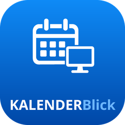

<p align="center">
  
</p>

# KALENDERBlick

[Änderungsprotokoll](CHANGELOG.md) · [Anleitung mit Screenshots](src/kalenderblick/hilfe/anleitung.md)

Zeigt die Termine aus **Thunderbird** auf dem Schreibtisch und in der
Kontrollleiste – ohne Thunderbird offen zu haben und ohne Zugangsdaten
irgendwo einzutragen. Gelesen wird ausschließlich, geschrieben nie.

Erprobt auf Arch/Manjaro mit KDE Plasma (Wayland), auf Debian mit
Cinnamon (X11) und auf Debian 13 mit GNOME (Wayland). Den vollen
Funktionsumfang gibt es unter KDE Plasma – was unter den anderen
Arbeitsumgebungen anders ist, steht weiter unten.

## Warum nicht einfach Rainlendar oder ein Plasma-Widget?

Weil keines von beiden an Thunderbirds Daten kommt. Rainlendar liest
iCalendar-Dateien, das Plasma-Widget „Event Calendar" kann Google und ICS –
Thunderbirds eigene Ablage kann keines von beiden. KALENDERBlick geht genau
dorthin: an die SQLite-Dateien im Profil. Damit siehst du **alle** Kalender auf
einmal, auch rein örtliche, und zwar genau so, wie Thunderbird sie kennt.

## Wie es an die Daten kommt

```
~/.thunderbird/<profil>/
   ├── prefs.js                     Namen, Farben, Art, Abholfrequenz
   └── calendar-data/
        ├── <kennung>.sqlite        ein Kalender je Datei
        └── …
```

* Zeiten stehen als Mikrosekunden seit 1970 in UTC, die Zeitzone getrennt
  daneben – deshalb wird mit Zeitzone gerechnet und erst zur Anzeige auf
  Ortszeit umgestellt.
* Wiederholungen stehen als `icalString` in `cal_recurrence` und werden mit
  `dateutil` entfaltet, samt `EXDATE` und abweichenden Einzelterminen.
* Ein laufender Thunderbird sperrt die Datei, deshalb wird vor dem Lesen eine
  Kopie gezogen.

## Installation

**Manjaro, Arch**

```bash
pamac install python-dateutil python-pyqt6 python-pipx
pipx install --system-site-packages git+https://github.com/Stephan-Lefty/KALENDERBlick.git
```

**Debian, GuideOS, Ubuntu**

```bash
sudo apt install python3-dateutil python3-pyqt6 pipx
pipx install --system-site-packages git+https://github.com/Stephan-Lefty/KALENDERBlick.git
```

KALENDERBlick ist reines Python mit Qt und hat außer `python-dateutil` keine
Abhängigkeiten. Es läuft überall dort, wo Thunderbird läuft – auch wenn
Thunderbird als Flatpak oder Snap installiert ist, denn deren Profilordner
werden mitgesucht.

## Zuerst ausprobieren

```bash
kalenderblick pruefen      # was wurde gefunden, welches Schema
kalenderblick kalender     # welche Kalender, wie oft wird abgeglichen
kalenderblick liste        # die nächsten Termine als Text
```

`kalender` beantwortet die Frage, die bei einem abonnierten Proton-Kalender
zuerst kommt: **wie oft holt Thunderbird eigentlich?**

```
Proton
   Art:      ics
   Abholung: alle 30 Minuten
   Zuletzt geschrieben: 01.11.2026 09:12  (vor 18 Minuten)
```

Die Abholfrequenz stellst du in Thunderbird ein: Rechtsklick auf den Kalender →
Eigenschaften → Aktualisieren. „Zuletzt geschrieben" ist der Zeitpunkt, an dem
sich tatsächlich etwas geändert hat – holt Thunderbird ab und es gibt nichts
Neues, bleibt der Stand stehen.

## Feiertage und Ferien

KALENDERBlick rechnet keine Feiertage oder Ferien selbst aus - es zeigt nur,
was in Thunderbird liegt. Dafür reicht ein zusätzlicher abonnierter Kalender
in Thunderbird; KALENDERBlick liest ihn automatisch mit, wie jeden anderen.

**Feiertage** (Deutschland und Österreich, als ICS-Abo, gültig 2025-2028):

```
https://www.thunderbird.net/media/caldata/autogen/GermanHolidays.ics
https://www.thunderbird.net/media/caldata/autogen/AustrianHolidays.ics
```

**Schulferien** nach Bundesland: [ferienwiki.de/exports/de](https://www.ferienwiki.de/exports/de).
Die Links dort tragen die Jahreszahl in der URL (z. B. `.../2026/de/bayern`) -
kein Dauerabo, die Adresse muss einmal im Jahr von Hand erneuert werden.

Einrichten in Thunderbird: Kalender → Rechtsklick → Kalender erstellen →
Im Netzwerk → URL einfügen. Die Abholfrequenz lässt sich dort wie bei jedem
anderen entfernten Kalender einstellen; `kalenderblick kalender` zeigt sie an.

## Was die Arbeitsumgebung beisteuern muss

Wie sich ein Fenster verhalten darf, entscheidet nicht das Programm,
sondern die Arbeitsumgebung. Daher die Unterschiede:

| | KDE Plasma (Wayland) | Cinnamon (X11) | GNOME (Wayland) |
|---|---|---|---|
| Leistensymbol | ✓ | ✓ | braucht `gnome-shell-extension-appindicator` |
| Feste Position | ✓ über KWin-Regel | ✓ | nicht möglich |
| Hinter allen Fenstern | ✓ | ✓ | nicht möglich |
| Nicht in der Fensterleiste | ✓ | ✓ | nicht möglich |
| Auf allen Arbeitsflächen | ✓ | – | – |

**KDE Plasma:** „Hinter anderen bleiben", „nicht in der Fensterleiste"
und „auf allen Arbeitsflächen" setzt KALENDERBlick selbst über ein kurzes
KWin-Skript durch, sobald das Widget erscheint - dafür ist nichts
einzurichten. Wird „Position sperren" eingeschaltet, legt das Programm
zusätzlich eine eigene KWin-Fensterregel an, damit die Stelle auch einen
Neustart übersteht; unter Wayland ist das der einzige Weg dorthin.
Fertig mitgeliefert, aber optional:
`packaging/kalenderblick.kwinrule` (Startposition und -größe, einzuspielen
über Systemeinstellungen → Fensterverwaltung → Fensterregeln → Importieren).

**Cinnamon/X11:** Hier darf sich das Fenster selbst positionieren, es
braucht also keine Regel.

**GNOME/Wayland:** Es gibt keine Schnittstelle für Fensterposition oder
Stapelreihenfolge - das Schreibtischfenster verhält sich wie jedes andere
Fenster. Das Leistensymbol erscheint nur mit der oben genannten
Erweiterung; fehlt sie, weist KALENDERBlick beim Start darauf hin und
öffnet stattdessen das Hauptfenster.

## Alle Befehle

| Befehl | Zweck |
|---|---|
| `pruefen` | Profile, Dateien, Tabellen und Spalten zeigen |
| `kalender` | Kalender mit Art, Abholfrequenz und Stand |
| `liste` | kommende Termine, `--tage`, `--alles`, `--ausfuehrlich` |
| `naechster` | der nächste Termin in einer Zeile |
| `einstellungen` | Vorausblick, Aktualisierung, Kalender verstecken |
| `fenster` | Fenster öffnen |
| `start` | Leistensymbol und Schreibtischfenster |

## Stand

Fertig und mit Tests abgedeckt. Die Oberfläche (`src/kalenderblick/gui/`)
besteht aus Schreibtischfenster, Leistensymbol und einem gewöhnlichen
Fenster mit drei Reitern (Termine, Einstellungen, Hilfe), alle auf
`TerminListe` aufgebaut. Vier Ansichten stehen fürs Schreibtischwidget
zur Wahl: Uhr + Datum, nächste 3 Termine, nächste 7 Tage, nächste
14 Tage - das Hauptfenster zeigt beim Durchklicken 31 Tage. Größe,
Transparenz und Dark-/Light-Mode lassen sich einstellen.

Die Schritt-für-Schritt-Anleitung mit Bildschirmfotos steht in
[Anleitung](src/kalenderblick/hilfe/anleitung.md) - und liegt zusätzlich
im Programm selbst unter „Hilfe", also auch ohne Internet lesbar.

## Lizenz

MIT
