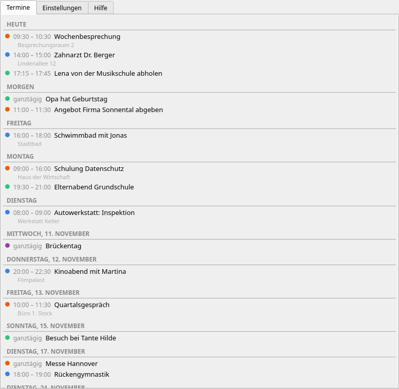
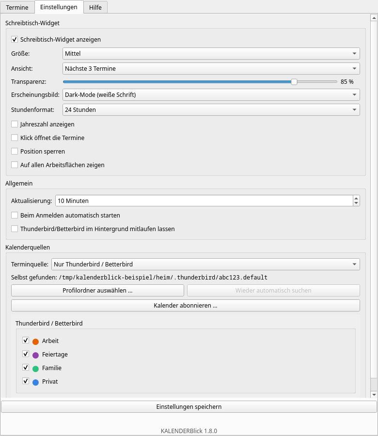
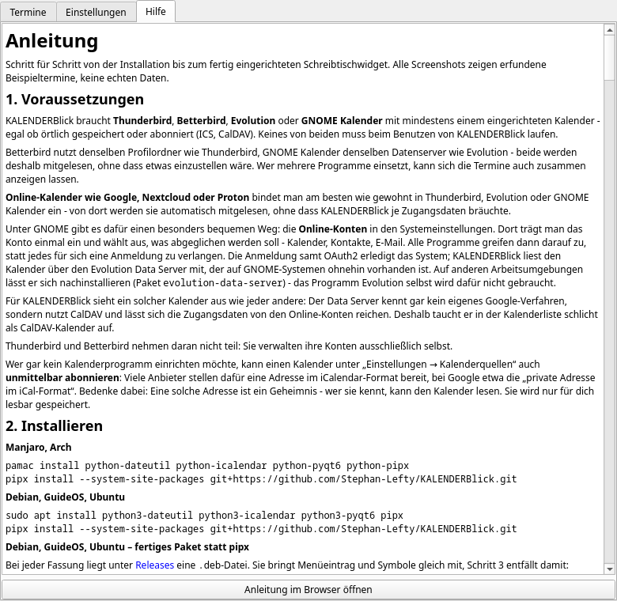
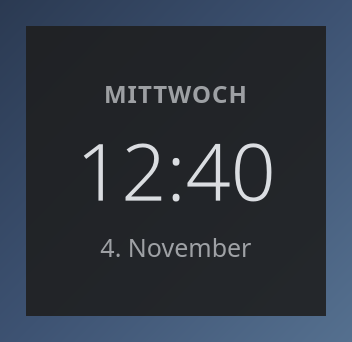
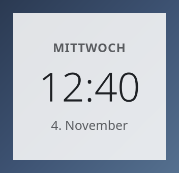
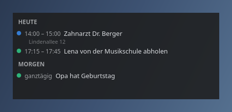
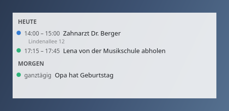
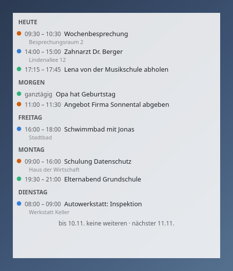
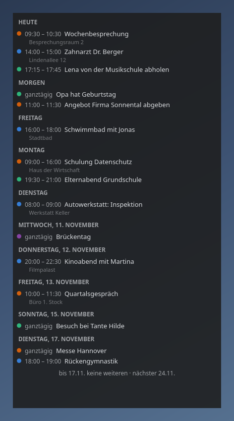
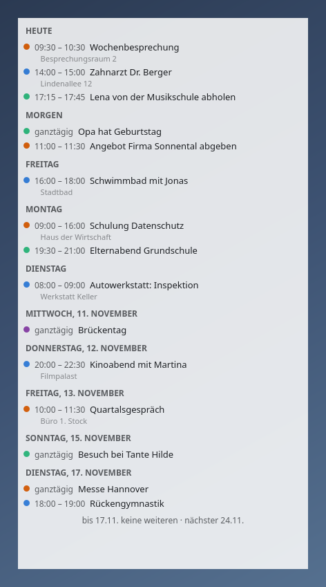

<p align="center">
  
</p>

# Anleitung

Schritt für Schritt von der Installation bis zum fertig eingerichteten
Schreibtischwidget. Alle Screenshots zeigen erfundene Beispieltermine,
keine echten Daten.

## 1. Voraussetzungen

KALENDERBlick braucht **Thunderbird**, **Betterbird**, **Evolution** oder
**GNOME Kalender** mit mindestens einem eingerichteten Kalender - egal ob örtlich gespeichert oder
abonniert (ICS, CalDAV). Keines von beiden muss beim Benutzen von
KALENDERBlick laufen.

Betterbird nutzt denselben Profilordner wie Thunderbird, GNOME Kalender
denselben Datenserver wie Evolution - beide werden deshalb
mitgelesen, ohne dass etwas einzustellen wäre. Wer mehrere Programme
einsetzt, kann sich die Termine auch zusammen anzeigen lassen.

**Online-Kalender wie Google, Nextcloud oder Proton** bindet man am
besten wie gewohnt in Thunderbird, Evolution oder GNOME Kalender ein -
von dort werden sie automatisch mitgelesen, ohne dass KALENDERBlick je
Zugangsdaten bräuchte.

Unter GNOME gibt es dafür einen besonders bequemen Weg: die
**Online-Konten** in den Systemeinstellungen. Dort trägt man das Konto
einmal ein und wählt aus, was abgeglichen werden soll - Kalender,
Kontakte, E-Mail. Alle Programme greifen dann darauf zu, statt jedes
für sich eine Anmeldung zu verlangen. Die Anmeldung samt OAuth2
erledigt das System; KALENDERBlick liest den Kalender über den
Evolution Data Server mit, der auf GNOME-Systemen ohnehin vorhanden
ist. Auf anderen Arbeitsumgebungen lässt er sich nachinstallieren
(Paket `evolution-data-server`) - das Programm Evolution selbst wird
dafür nicht gebraucht.

Für KALENDERBlick sieht ein solcher Kalender aus wie jeder andere:
Der Data Server kennt gar kein eigenes Google-Verfahren, sondern
nutzt CalDAV und lässt sich die Zugangsdaten von den Online-Konten
reichen. Deshalb taucht er in der Kalenderliste schlicht als
CalDAV-Kalender auf.

Thunderbird und Betterbird nehmen daran nicht teil: Sie verwalten ihre Konten
ausschließlich selbst.

Wer gar kein Kalenderprogramm einrichten möchte, kann einen Kalender
unter „Einstellungen → Kalenderquellen“ auch **unmittelbar abonnieren**:
Viele Anbieter stellen dafür eine Adresse im iCalendar-Format bereit, bei
Google etwa die „private Adresse im iCal-Format“. Bedenke dabei: Eine
solche Adresse ist ein Geheimnis - wer sie kennt, kann den Kalender
lesen. Sie wird nur für dich lesbar gespeichert.

## 2. Installieren

**Manjaro, Arch**

```bash
pamac install python-dateutil python-icalendar python-pyqt6 python-pipx
pipx install --system-site-packages git+https://github.com/Stephan-Lefty/KALENDERBlick.git
```

**Debian, GuideOS, Ubuntu**

```bash
sudo apt install python3-dateutil python3-icalendar python3-pyqt6 pipx
pipx install --system-site-packages git+https://github.com/Stephan-Lefty/KALENDERBlick.git
```

**Debian, GuideOS, Ubuntu – fertiges Paket statt pipx**

Bei jeder Fassung liegt unter
[Releases](https://github.com/Stephan-Lefty/KALENDERBlick/releases) eine
`.deb`-Datei. Sie bringt Menüeintrag und Symbole gleich mit, Schritt 3
entfällt damit:

```bash
sudo apt install ./kalenderblick_*_all.deb
```

Wichtig ist `apt install ./…` und **nicht** `dpkg -i`: Nur apt holt die
benötigten Pakete (`python3-dateutil`, `python3-icalendar`,
`python3-pyqt6`) selbst dazu.

Danach stehen zwei Befehle zur Verfügung: `kalenderblick` (Kommandozeile)
und `kalenderblick-fenster` (nur das Hauptfenster, ohne Leistensymbol und
Schreibtischwidget).

### Aus einem Arbeitsordner statt von GitHub

Wer das Projekt ausgecheckt hat und einen eigenen Stand ausprobieren
will, gibt statt der Adresse den Ordner an:

```bash
pipx uninstall kalenderblick
pipx install --system-site-packages /pfad/zum/kalenderblick
```

Erst entfernen, dann neu einspielen: `pipx install --force` scheitert,
wenn pipx im Hintergrund `uv` benutzt - das legt keine Umgebung über
eine bestehende und bricht mit „a virtual environment already exists"
ab. `--system-site-packages` darf dabei nicht fehlen, sonst findet die
neue Umgebung PyQt6 nicht, und es gibt weder Fenster noch
Leistensymbol - nur die Befehle für die Kommandozeile.

## 3. Menüeintrag und Symbole einrichten

`pipx install` legt nur die beiden Befehle an, keinen Eintrag im
Anwendungsmenü und keine Symbole. Das holt dieser Block nach - einmalig,
unabhängig vom Betriebssystem:

```bash
VENV=$(pipx environment --value PIPX_LOCAL_VENVS)/kalenderblick
BILDER=$(find "$VENV" -type d -name bilder | head -1)

for groesse in 16 22 24 32 48 64 128 256 512; do
  mkdir -p ~/.local/share/icons/hicolor/${groesse}x${groesse}/apps
  cp "$BILDER/symbol-${groesse}.png" \
     ~/.local/share/icons/hicolor/${groesse}x${groesse}/apps/kalenderblick.png
done

mkdir -p ~/.local/share/applications
cat > ~/.local/share/applications/kalenderblick.desktop << 'EOF'
[Desktop Entry]
Type=Application
Name=KALENDERBlick
Comment=Termine auf dem Schreibtisch und in der Kontrollleiste
Exec=kalenderblick start
Icon=kalenderblick
Terminal=false
Categories=Office;Calendar;Utility;
StartupNotify=false
EOF
update-desktop-database ~/.local/share/applications
```

Danach steht „KALENDERBlick" im Anwendungsmenü - meist ohne Neustart von
Plasma. Wer lieber das fertige `.deb`- oder Arch-Paket nutzt (siehe
`packaging/`), bekommt Menüeintrag und Symbole automatisch mit.

## 4. Kurz prüfen, ob das Profil gefunden wird

```bash
kalenderblick pruefen
kalenderblick kalender
```

`pruefen` zeigt, welches Thunderbird-Profil gefunden wurde und ob die
Kalenderdateien lesbar sind. `kalender` listet jeden gefundenen Kalender
mit Art und Abholfrequenz - das sollten echte, bekannte Kalendernamen
sein. Wenn hier nichts oder das falsche Profil erscheint, lässt sich ein
bestimmtes Profil von Hand vorgeben (siehe Abschnitt „Kalenderquellen"
weiter unten).

Diese beiden Befehle sehen nur in Thunderbird nach. Evolution, GNOME
Kalender und abonnierte Kalender erscheinen nicht hier, sondern im
Programm selbst unter „Einstellungen → Kalenderquellen".

## 5. Starten

```bash
kalenderblick start
```

Das legt ein Symbol in die Kontrollleiste. Beim allerersten Start sind
alle Schalter für das Schreibtischwidget bewusst ausgeschaltet - es
erscheint also zunächst **nur** das Leistensymbol, kein Fenster auf dem
Schreibtisch. Ein Klick auf das Symbol öffnet das Hauptfenster mit dem
Reiter „Termine":



Die Termine der nächsten 31 Tage, nach Tagen gruppiert. Farbpunkt zeigt
den Kalender, bei örtlichen Terminen steht der Ort direkt darunter.

## 6. Einstellungen

Zweiter Reiter im Hauptfenster:



**Schreibtisch-Widget**

| Schalter | Bedeutung |
|---|---|
| Schreibtisch-Widget anzeigen | Ob überhaupt ein Fenster auf dem Schreibtisch liegt. Wirkt sofort beim Speichern; das Leistensymbol bleibt davon unberührt. |
| Größe | Fünf Stufen von „Sehr klein" bis „Sehr groß". Gesteuert wird damit die Breite des Fensters; die Höhe richtet sich immer nach dem Inhalt - so weit, wie Termine da sind, höchstens bis zum Bildschirmrand. Bei der Uhr-Ansicht steuert die Größe stattdessen die Schriftgröße („Sehr klein" ergibt rund 100 × 110 Pixel, gedacht für ältere Geräte mit 1920er Auflösung). |
| Ansicht | Welche der vier Ansichten unten gezeigt wird. Sie bestimmt zugleich den Zeitraum: „Nächste 7 Tage" reicht bis einschließlich des siebten Tages, „Nächste 14 Tage" bis zum vierzehnten - jeweils mit dem heutigen Tag als erstem. Der Reiter „Termine" in diesem Fenster zeigt davon unabhängig immer einen ganzen Monat, weshalb dort mehr stehen kann als im Widget. |
| Transparenz | Wie durchsichtig der Hintergrund ist - 0 % nur Schrift, 100 % voll deckend. |
| Erscheinungsbild | Dark-Mode (weiße Schrift) oder Light-Mode (schwarze Schrift) - wirkt nur auf das Widget, nicht auf dieses Fenster. |
| Stundenformat | 24 Stunden oder 12 Stunden mit AM/PM - nur für die Uhr-Ansicht. |
| Jahreszahl anzeigen | Nur für die Uhr-Ansicht: stellt die Jahreszahl als eigene Zeile unter das Datum. |
| Klick öffnet die Termine | Ein Klick auf das Widget öffnet das Hauptfenster. Ausgeschaltet lässt sich das Widget nur noch ziehen oder über das Leistensymbol öffnen. |
| Position sperren | Einmal an die richtige Stelle gezogen, lässt sich das Fenster nicht mehr versehentlich verschieben - und bleibt auch über einen Neustart von KALENDERBlick an dieser Stelle (nur KDE/KWin, über eine automatisch angelegte Fensterregel). |
| Auf allen Arbeitsflächen zeigen | Das Widget bleibt sichtbar, egal auf welche Arbeitsfläche gewechselt wird - nur unter KDE/KWin wirksam. |

**Allgemein**

| Schalter | Bedeutung |
|---|---|
| Terminquelle | Aus welchem Kalenderprogramm gelesen wird: alles, was gefunden wird, oder gezielt nur Thunderbird/Betterbird beziehungsweise nur Evolution/GNOME Kalender. Abonnierte Kalender kommen unabhängig davon immer dazu. |
| Aktualisierung | Wie oft die Oberfläche die Daten neu einliest. Bei Thunderbird/Betterbird und Evolution ersetzt das nicht deren eigene Abholfrequenz - erst wenn das Kalenderprogramm selbst abgeholt hat, gibt es hier etwas Neues zu sehen. Abonnierte Kalender ruft KALENDERBlick selbst ab, höchstens alle 30 Minuten. |
| Thunderbird/Betterbird im Hintergrund mitlaufen lassen | Startet das Programm alle 30 Minuten für anderthalb Minuten ohne Fenster, damit entfernte Kalender auch ohne geöffnetes Programm abgeholt werden. Aus, solange nichts anderes eingestellt ist. Näheres unten unter „Wann kommen neue Termine an?". |
| Beim Anmelden automatisch starten | Legt eine `.desktop`-Datei in `~/.config/autostart/` an oder entfernt sie wieder. |

**Kalenderquellen** - ganz unten: Zuoberst lässt sich wählen, woher die
Termine kommen sollen - aus Thunderbird/Betterbird, aus Evolution oder aus beidem
zusammen („Alles, was gefunden wird“). Darunter steht, welches
Thunderbird-Profil verwendet wird. Normalerweise findet KALENDERBlick es
von selbst; liegt es an einer ungewöhnlichen Stelle (eigene Partition,
verschobener Benutzerordner), lässt es sich über „Profilordner
auswählen …“ von Hand angeben. Gesucht wird dabei der Ordner, der einen
Unterordner namens `calendar-data` enthält - wird eine Ebene zu hoch
gewählt, findet KALENDERBlick ihn meist trotzdem. „Wieder automatisch
suchen“ verwirft die eigene Angabe.

Darunter stehen alle gefundenen Kalender, nach Herkunft gruppiert -
eine Zeile je Kalender mit Farbpunkt und Namen. Wer es genauer wissen
will, hält den Mauszeiger darüber: Art, Abholfrequenz, wann zuletzt
geschrieben wurde und ob der Kalender abgeschaltet oder nur lesbar ist.
Praktisch zum Nachsehen, warum ein Kalender nicht wie erwartet
auftaucht.

Mit **„Kalender abonnieren …“** lässt sich ein Kalender unmittelbar über
seine Internetadresse einbinden - ohne Kalenderprogramm. KALENDERBlick
ruft ihn dann selbst ab, höchstens alle 30 Minuten. Abonnierte Kalender
erscheinen in der Liste unter „Abonniert“ und lassen sich dort mit dem
Kreuz wieder entfernen; beim Anbieter ändert sich dadurch nichts.

### Wann kommen neue Termine an?

Das hängt davon ab, wer den Kalender abholt:

| Kalender liegt in | neue Termine erscheinen |
|---|---|
| Thunderbird oder Betterbird, örtlich gespeichert | sofort, sobald das Programm sie geschrieben hat |
| Thunderbird oder Betterbird, entfernt (CalDAV oder ICS) | erst wenn **das Programm läuft** und abgeholt hat - es ist kein Hintergrunddienst, bei geschlossenem Programm bleibt die Datei stehen |
| Evolution oder GNOME Kalender | **auch bei geschlossenem Fenster** - der Evolution Data Server läuft als eigener Dienst weiter und holt nach dem eingestellten Takt ab |
| in KALENDERBlick abonniert | unabhängig von jedem Kalenderprogramm, höchstens alle 30 Minuten |

Für Betterbird gilt dasselbe wie für Thunderbird - es ist derselbe
Programmkern mit demselben Profil.

Für Thunderbird und Betterbird gibt es dagegen den Schalter
**„Thunderbird/Betterbird im Hintergrund mitlaufen lassen"**. Er startet
das Programm alle 30 Minuten für 90 Sekunden ohne Fenster; in dieser
Zeit holt es ab wie sonst auch - samt der CalDAV-Kalender, für die nur
es selbst die Zugangsdaten hat. Danach wird es wieder beendet.

Zwei Dinge dazu:

- Der Schalter ist von Haus aus **aus** und bleibt es, bis man ihn
  selbst umlegt. Er endet außerdem zusammen mit KALENDERBlick.
- Während eines solchen Abholfensters hält das Programm die
  Profilsperre. Klickt man **genau dann** auf Thunderbird oder
  Betterbird, öffnet sich kein Fenster - ein zweiter Versuch eine
  Minute später hilft. Darum dauern die Fenster nur 90 Sekunden statt
  durchzulaufen.

Wer sein Kalenderprogramm selten öffnet, aber trotzdem aktuelle Termine
sehen will, abonniert den Kalender besser unmittelbar hier. Das geht
allerdings nur mit iCalendar-Adressen (`https://…`, oft auf `.ics`
endend); das CalDAV-Protokoll beherrscht KALENDERBlick nicht. Manche
Anbieter stellen für denselben Kalender beides bereit - dann ist die
iCalendar-Adresse die richtige.

Welcher Art ein Kalender ist, steht im Mauszeiger-Hinweis in der Liste
darüber oder in der Ausgabe von `kalenderblick kalender`. Die Adresse
eines in Thunderbird eingebundenen ICS-Kalenders lässt sich von dort
übernehmen - sie steht in den Eigenschaften des Kalenders.

**Dabei den Kalender in Thunderbird abwählen.** Steht derselbe Kalender
sowohl in Thunderbird als auch unter „Abonniert", liest KALENDERBlick
ihn zweimal und zeigt jeden Termin doppelt - die Quellen werden
zusammengeführt, ohne auf Dubletten zu prüfen. In der Kalenderliste
lässt sich der Haken beim Thunderbird-Eintrag entfernen; in Thunderbird
selbst bleibt dann alles, wie es war.

Jeder Kalender hat ein **Ankreuzfeld**: Abgewählte erscheinen weder im
Schreibtischwidget noch in der Terminliste. Das betrifft ausschließlich
die Anzeige in KALENDERBlick - in Thunderbird beziehungsweise Evolution
bleibt alles unverändert sichtbar.

Ganz unten steht die laufende Fassungsnummer - praktisch bei Rückfragen.
Ein dritter Reiter „Hilfe" enthält genau diese Anleitung samt
Bildschirmfotos, auch ohne Internet; ein Knopf dort öffnet sie
zusätzlich im Webbrowser, wo die Bilder in voller Größe erscheinen und
sich ausdrucken lassen.

Mit „Einstellungen speichern" werden alle Änderungen sofort auf das
laufende Schreibtischwidget angewendet - ohne Neustart, mit Ausnahme von
„Schreibtisch-Widget anzeigen" selbst.

Der dritte Reiter **„Hilfe"** enthält diese Anleitung samt Bildern,
auch ohne Internet lesbar. Der Knopf darunter öffnet sie zusätzlich im
Browser:



## 7. Die vier Ansichten des Schreibtischwidgets

Jede Ansicht gibt es in Dark- und Light-Mode. Der Kasten ist bei allen
Ansichten nur so groß wie der Inhalt - bei wenig Terminen bleibt kein
durchscheinender Leerraum stehen.

Die beiden Tage-Ansichten schließen mit einer Zeile ab, die das Ende
ihres Zeitraums nennt („bis 17.11. keine weiteren"). Liegt im Zeitraum
überhaupt nichts, steht stattdessen mittig im Kasten, bis wann geschaut
wurde und wann der nächste Termin ansteht. So ist ein leeres Widget als
Auskunft erkennbar und nicht als Fehler.

**Uhr + Datum** - Wochentag, Uhrzeit, Datum, sonst nichts:




**Nächste 3 Termine** - unabhängig vom Datum immer die drei nächsten
anstehenden, bereits vergangene Termine des Tages fallen raus:




**Nächste 7 Tage** - alle Termine der kommenden Woche, nach Tagen
gruppiert, bis einschließlich des siebten Tages:




**Nächste 14 Tage** - wie oben, nur zwei Wochen weit. Bei viel Inhalt
stößt der Kasten an die eingestellte Größen-Obergrenze; der Rest lässt
sich mit dem Mausrad durchscrollen. Umgekehrt kann hier weniger stehen
als im Reiter „Termine", der immer einen ganzen Monat zeigt:




## 8. Das Widget auf dem Schreibtisch

Nach dem Einschalten liegt das Widget hinter allen anderen Fenstern. Zum
Verschieben an eine freie Stelle klicken und ziehen (falls „Position
sperren" aus ist) - unter KDE/Plasma rastet es dabei wie jedes andere
Fenster am Bildschirmrand ein. Danach „Position sperren" einschalten,
damit es nicht mehr versehentlich verrutscht.

## 9. Wayland und KWin (nur KDE Plasma)

Unter Wayland kann sich ein Fenster nicht selbst positionieren - dafür
gibt es eine optionale Fensterregel mit Startposition und -größe:
`packaging/kalenderblick.kwinrule`.

Einspielen: Systemeinstellungen → Fensterverwaltung → Fensterregeln →
Regeln importieren → die Datei wählen.

Alles andere - unter anderen Fenstern bleiben, nie in der Taskleiste oder
im Fensterwechsler auftauchen, auf allen Arbeitsflächen zeigen - erzwingt
KALENDERBlick selbst über ein kurzes KWin-Skript, sobald das Widget
erscheint. Dafür ist keine Regel nötig, das funktioniert unabhängig davon,
wie das Programm gestartet wurde.

Unter X11 (z. B. Cinnamon oder Xfce) braucht es keine Regel,
KALENDERBlick positioniert sich dort selbst.

## 10. GNOME

Unter GNOME gelten zwei Einschränkungen, beide liegen an der
Arbeitsumgebung selbst und nicht an KALENDERBlick:

**Das Leistensymbol braucht eine Erweiterung.** GNOME zeigt seit Fassung
3.26 keine Leistensymbole mehr von sich aus an. Abhilfe:

```bash
sudo apt install gnome-shell-extension-appindicator
```

Danach einmal ab- und wieder anmelden. Ohne diese Erweiterung läuft
KALENDERBlick zwar, aber ohne Symbol in der Leiste - dann erscheint beim
Start stattdessen das Hauptfenster, damit überhaupt etwas zu sehen ist.

**Das Schreibtischwidget ist ein gewöhnliches Fenster.** Unter
GNOME/Wayland lässt sich weder eine feste Position noch „hinter allen
anderen Fenstern" durchsetzen - dafür gibt es dort keine Schnittstelle.
Das Widget verhält sich deshalb wie jedes andere Fenster. „Position
sperren" verhindert immerhin das versehentliche Verschieben innerhalb
einer Sitzung.

## 11. Wenn etwas nicht passt

| Problem | Lösung |
|---|---|
| Kein Termin zu sehen | `kalenderblick pruefen` und `kalenderblick kalender` - zeigt, welches Profil gefunden wurde und ob Kalender abgeschaltet sind. |
| Falsches oder gar kein Profil gefunden | Unter „Einstellungen → Kalenderquellen“ auf „Profilordner auswählen …“ - oder auf der Kommandozeile: `kalenderblick einstellungen --profil /pfad/zum/profil`. |
| Kalender hinkt hinterher | Bei Thunderbird/Betterbird und Evolution ist das deren eigene Abholfrequenz, nicht KALENDERBlicks Aktualisierung - siehe „Kalenderquellen" in den Einstellungen. Direkt abonnierte Kalender holt KALENDERBlick höchstens alle 30 Minuten. |
| Widget bleibt unsichtbar | In den Einstellungen „Schreibtisch-Widget anzeigen" einschalten und KALENDERBlick neu starten. |
| Widget fast leer, Hauptfenster voll | Kein Fehler: Das Widget zeigt nur den Zeitraum der gewählten Ansicht (7 oder 14 Tage), der Reiter „Termine" dagegen einen ganzen Monat. Liegt im Zeitraum nichts mehr, nennt das Widget unten das Datum, bis zu dem es schaut, und den nächsten Termin dahinter. |
| Thunderbird/Betterbird öffnet kein Fenster | Läuft der Schalter „Thunderbird/Betterbird im Hintergrund mitlaufen lassen", ist das Programm alle 30 Minuten für anderthalb Minuten belegt. Eine Minute warten und erneut versuchen - oder den Schalter ausschalten. |
| Termine aus Evolution fehlen | Prüfen, ob unter „Terminquelle" nicht versehentlich „Nur Thunderbird / Betterbird" eingestellt ist. |
| Abonnierter Kalender zeigt nichts | Die Adresse muss auf eine iCalendar-Datei zeigen (endet meist auf `.ics`). Bei Google ist es die **private** Adresse, nicht die öffentliche. |
| Kein Symbol in der Leiste (GNOME) | Die Erweiterung `gnome-shell-extension-appindicator` installieren und sich einmal neu anmelden - siehe Abschnitt 10. |
| Zweites Fenster lässt sich nicht öffnen | KALENDERBlick läuft schon - ein Blick ins Leistensymbol genügt, ein zweiter gleichzeitiger Start ist bewusst gesperrt. |
